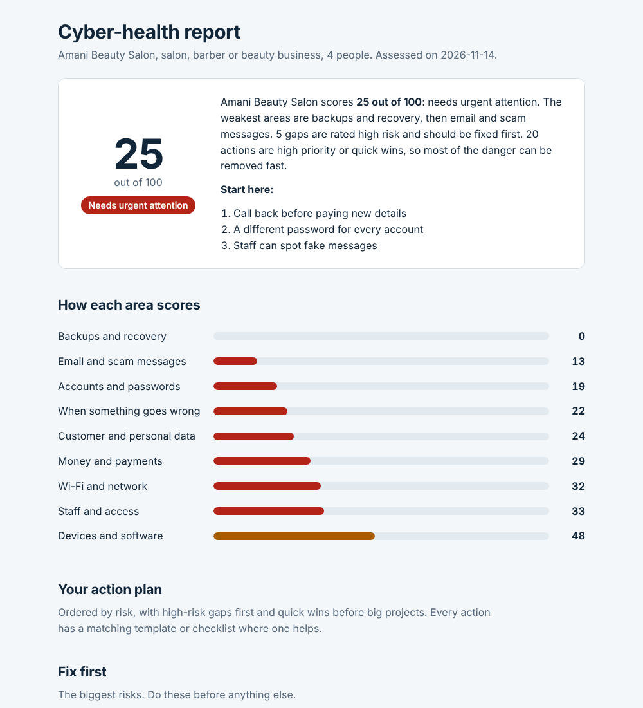

# CyberCheckup: a cyber-health check-up for small businesses



CyberCheckup is an offline command-line tool that interviews a small business about its everyday security habits and turns the answers into a complete, ready-to-use security package: a scored risk assessment, a prioritised action plan, filled-in policy templates, and a staff briefing. It is built for the businesses that big security products ignore: a local shop, a salon, a clinic, a school, an NGO, a startup.

---

## Table of contents

1. [The problem](#1-the-problem)
2. [What CyberCheckup produces](#2-what-cybercheckup-produces)
3. [Quick start](#3-quick-start)
4. [How an assessment works](#4-how-an-assessment-works)
5. [What it asks about](#5-what-it-asks-about)
6. [How the score is calculated](#6-how-the-score-is-calculated)
7. [The action plan](#7-the-action-plan)
8. [Policy templates](#8-policy-templates)
9. [The staff briefing](#9-the-staff-briefing)
10. [Command reference](#10-command-reference)
11. [Input and output formats](#11-input-and-output-formats)
12. [Customising the knowledge base](#12-customising-the-knowledge-base)
13. [Architecture and project layout](#13-architecture-and-project-layout)
14. [Testing](#14-testing)
15. [Security and privacy design](#15-security-and-privacy-design)
16. [Limitations](#16-limitations)
17. [Using it responsibly with real businesses](#17-using-it-responsibly-with-real-businesses)
18. [What this project demonstrates](#18-what-this-project-demonstrates)
19. [Troubleshooting](#19-troubleshooting)
20. [Roadmap](#20-roadmap)
21. [License](#21-license)

---

## 1. The problem

A small business does not know its biggest cyber risks or which fixes to do first. It cannot afford a security consultant, and the advice online is written for IT departments. Meanwhile the real threats are ordinary: a reused password, a fake "send the money back" message, a hijacked social media page, no backup when ransomware strikes, a stolen phone with mobile money on it.

CyberCheckup answers two questions for the owner, in plain language:

* **What are our biggest risks?**
* **What should we fix first, this week, with the least effort?**

## 2. What CyberCheckup produces

| Deliverable | Files | What it is |
|---|---|---|
| **Risk assessment** | `report.html` | An overall score out of 100, a score for each of nine areas, a risk register of every gap, and a list of what the business already does well |
| **Prioritised action plan** | `report.html`, `action-plan.csv` | Actions grouped as *Fix first*, *This week*, *This month* and *This quarter*, ordered by risk and effort. The CSV is a tracking sheet with owner, due date and status columns |
| **Policy templates** | `policies/*.html`, `policies/*.md` | Up to seven short policies, already filled with the business name, owner and review dates, generated only for the gaps that were found |
| **Staff briefing** | `staff-briefing.html`, `staff-briefing.md` | A 30-minute session plan with scams specific to the business's sector, the five rules most relevant to its gaps, a quiz with answers, and a printable poster |
| **Saved answers** | `assessment.json` | The inputs and results, so the assessment can be re-run, edited, or compared with a later one |

Everything is generated locally. No account, no cloud service, and no data leaves the computer.

## 3. Quick start

Requirements: Python 3.10 or newer.

```bash
git clone <your-repo-url> cybercheckup
cd cybercheckup
python -m venv .venv
source .venv/bin/activate          # Windows: .venv\Scripts\activate
pip install -e ".[dev]"

cybercheckup demo                  # sample report for a fictional salon
```

Open `cybercheckup-output/demo/report.html` in a browser. Then try a real interview:

```bash
cybercheckup assess
```

A short session looks like this:

```
Business name: Mama Mboga Shop
Owner or manager's name: Grace
What kind of business is it?
  1. Shop or retail business
  2. Salon, barber or beauty business
  ...
How many people work there, including you? 3

== Accounts and passwords ==

(1/36) Does each important account (email, bank, mobile money, social media)
have its own password, so that no password is used twice?
> ?
Why it matters: When one website is breached, criminals try the same password
on email, banking and social media.
> n
```

Answer each question with `y` (yes), `p` (partly), `n` (no), `u` (not sure), `s` (not applicable), or `?` to see why the question matters.

## 4. How an assessment works

```
 questions.yaml   profiles.yaml      answers (interview or JSON file)
        \              |                  /
         v             v                 v
        +---------------------------------+
        |  model.assess()                 |   score each control,
        |  weights, gaps, risk, phases    |   weight by sector,
        +----------------+----------------+   rank the gaps
                         |
                  Assessment object
                         |
      +---------+--------+---------+-----------+
      v         v        v         v           v
  report.py  policies.py briefing.py  CSV    assessment.json
      \         |        |         /           /
       +--------+--------+--------+------------+
                         v
                  build.write_all()  ->  one folder of deliverables
```

1. **Profile.** The tool asks for the business name, owner, sector and number of people. The sector adjusts how risks are weighted and which scams appear in the staff briefing. The headcount decides whether staff-related questions apply (a one-person business is not asked about offboarding staff).
2. **Questionnaire.** The business answers between 31 and 36 plain-language questions, depending on sector and headcount. Each question is one security control.
3. **Scoring.** Every gap becomes a risk number, and the risks roll up into area scores and an overall score.
4. **Prioritisation.** Gaps are sorted into phases by risk and effort.
5. **Generation.** The report, action plan, policies and staff briefing are written to a folder.

## 5. What it asks about

The knowledge base contains 37 controls in nine areas.

| Area | Controls | What it covers |
|---|---|---|
| Accounts and passwords | 4 | Password reuse, two-step verification, shared logins, recovery if the owner's phone is lost |
| Email and scam messages | 3 | Spotting fake messages, business email, never sharing PINs or one-time codes |
| Devices and software | 6 | Automatic updates, antivirus, screen locks, pirated software, device list, remote lock or wipe |
| Wi-Fi and network | 4 | Wi-Fi security, router admin password, guest Wi-Fi, cameras and printers |
| Backups and recovery | 3 | Regular backups, a separate or off-site copy, tested restores |
| Money and payments | 5 | Call-back before paying new details, two-person approval, mobile money phone and SIM protection, weekly statement checks, card machine tampering (shops) |
| Customer and personal data | 4 | Knowing what data you hold, keeping it out of sight and out of group chats, restricting sensitive records, privacy notice and regulator registration |
| Staff and access | 4 | Access matching the job, same-day removal of leavers, briefing new staff, outside helpers |
| When something goes wrong | 4 | A written who-to-call list, reporting without blame, numbers to block a SIM or wallet, trading without computers |

Some questions apply only to certain businesses. Card machine checks are asked of shops, sensitive-records handling of clinics, schools and NGOs, and four staff-related questions need at least two people.

Each question carries: a plain-language question, a short title, **why it matters**, **how to fix it**, a rating for impact, likelihood and effort, an optional matching policy template, and an optional one-line rule for staff.

### Sectors

| Sector | Weighted up | Example scenarios in the staff briefing |
|---|---|---|
| Shop or retail | Payments, backups, devices | Fake "sent by mistake" money messages, a caller asking for the till-line code |
| Salon, barber or beauty | Payments, accounts, email | Hijacked Instagram or Facebook page, fake brand-partnership login pages |
| Clinic, pharmacy or health | Data, backups, people | Ransomware on patient records, patient files photographed on WhatsApp |
| School or training college | Data, people, email | Fake "head teacher" payment requests, shared teacher passwords |
| NGO or community organisation | Email, data, payments, accounts | Fake donor emails, a lost laptop with beneficiary lists |
| Startup or small tech business | Accounts, backups, data, devices | Keys leaked in a code repository, a former contractor with access |
| Other | None | General bank-impersonation, boss-impersonation and stolen-phone scenarios |

## 6. How the score is calculated

Each control has three ratings:

| Rating | Scale | Meaning |
|---|---|---|
| Impact | 1 to 5 | How bad it is if the control is missing |
| Likelihood | 1 to 5 | How often small businesses actually get hit through this gap |
| Effort | 1 to 3 | 1 = under an hour and usually free, 2 = about a day or a small cost, 3 = a project |

An answer becomes a number: **yes** = 1.0, **partly** = 0.5, **no** = 0.0 and **not sure** = 0.0. The **gap** is `1 - value`.

```
maximum risk  = likelihood x impact x sector weight
risk          = maximum risk x gap
area score    = 100 x (1 - sum of risks / sum of maximum risks)
overall score = the same formula over all applicable controls
```

**Worked example.** The demo salon answers "no" to *Call back before paying new details* (likelihood 4, impact 5). Payments carry a weight of 1.3 for salons, so the maximum risk is 4 x 5 x 1.3 = 26. With a gap of 1, the risk is 26. That is above 18, so it lands in *Fix first*. If the salon had answered "partly", the risk would be 13 and the action would move to *This week*, because the fix takes under an hour.

Details:

* "Not applicable" answers are left out of the sums, as are controls that do not apply to the business.
* "Not sure" counts as "no", but the report tells the owner to find out first.
* Unanswered questions (in a JSON file) are treated as "not sure" and the report says how many there were.
* Score bands: 80 or more **Healthy**, 60 to 79 **Fair**, 40 to 59 **At risk**, below 40 **Needs urgent attention**.

The ratings are judgement-based, drawn from public incident patterns and practitioner experience. They are not measured probabilities. The full reasoning is in [docs/METHODOLOGY.md](docs/METHODOLOGY.md).

## 7. The action plan

Every gap becomes an action, placed in one of four phases:

| Phase | Rule | Why |
|---|---|---|
| **Fix first** | Risk of 18 or more, whatever the effort | The biggest dangers come before everything else |
| **This week** | Effort 1 | Quick wins, under an hour and usually free |
| **This month** | Effort 2 | About a day, or a small cost |
| **This quarter** | Effort 3 | Larger projects needing time or budget |

Inside each phase the highest risk comes first. Each action shows what to do, why it matters, the risk level (High at 18 or more, Medium at 9 or more, otherwise Low), the effort, what the owner answered, and a link to the matching policy template. The first three actions are repeated at the top of the report under **Start here**.

`action-plan.csv` contains the same actions with blank `owner` and `due_date` columns and a `status` column that starts as "To do", ready to open in Excel or Google Sheets.

## 8. Policy templates

Seven short policies, written in plain language, with tables the business can fill in:

| Policy | Covers |
|---|---|
| Passwords and account access | One password per account, two-step verification, key account register |
| Staff acceptable use and security rules | Seven rules, joiner, mover and leaver steps, outside helpers, signature table |
| Customer and personal data | Data inventory, handling rules, people's rights, breach reporting, registration |
| Backup and recovery | What is backed up, the 3-2-1 idea, restore test log |
| Payment verification | Call-back rule, two-person approval, mobile money protection, limits table |
| Devices, Wi-Fi and mobile phones | Updates, locks, remote wipe, router and guest Wi-Fi, device list |
| Incident response plan | First-hour steps, who-to-call table, afterwards review, trading without systems |

The templates are filled automatically with `{{business_name}}`, `{{owner}}`, `{{date}}`, `{{review_date}}` (one year later) and `{{staff_count}}`. Only policies linked to a gap are generated, and the incident response plan is always included. Each comes as editable Markdown and as a printable HTML page.

The templates are general guidance, not legal advice. References to Kenya's data protection regulator (the ODPC) can be changed for other countries.

## 9. The staff briefing

A 30-minute session for everyone, including the owner:

1. Why we are doing this (3 minutes)
2. Scams aimed at businesses like ours (7 minutes), using the sector's own scenarios
3. Our five rules (10 minutes), chosen from the business's highest-risk gaps and topped up with defaults
4. What we are changing (3 minutes), the top three fixes from the assessment
5. If something goes wrong (2 minutes), with the "report fast, never punished" message
6. Quick quiz (5 minutes), five questions with answers

A printable poster of the five rules is at the end of `staff-briefing.html`.

## 10. Command reference

| Command | What it does |
|---|---|
| `cybercheckup assess` | Interactive questionnaire, then writes all deliverables |
| `cybercheckup assess --answers FILE` | Skips the questions and builds everything from a JSON file |
| `cybercheckup assess --out DIR` | Chooses the output folder (default `cybercheckup-output/<business>-<date>`) |
| `cybercheckup demo [--out DIR]` | Generates a sample report for a fictional salon |
| `cybercheckup compare OLD NEW` | Compares two `assessment.json` files: score changes by area, gaps fixed, new gaps |
| `cybercheckup --version` | Prints the version |

If the `cybercheckup` command is not found, use `python -m cybercheckup` instead. Bad input prints a clear `error:` message and exits with code 2 rather than a stack trace.

## 11. Input and output formats

### Answers file

```json
{
  "business": {
    "name": "Amani Beauty Salon",
    "owner": "Wanjiru",
    "sector": "salon",
    "staff": 4
  },
  "date": "2026-11-14",
  "answers": {
    "ACC-01": "no",
    "ACC-02": "partly",
    "PAY-01": "no",
    "BAK-01": "yes",
    "PAY-02": "skip"
  }
}
```

* `sector` is one of `shop`, `salon`, `clinic`, `school`, `ngo`, `startup`, `other`.
* Answer values are `yes`, `partly`, `no`, `unsure` or `skip`. Anything else is rejected with an error naming the question.
* Question ids that do not exist are ignored, so older files keep working when the question bank changes.
* `date` is optional and defaults to today.

A complete example is in `cybercheckup/data/demo.json`.

### Output folder

```
cybercheckup-output/amani-beauty-salon-2026-11-14/
  report.html
  action-plan.csv
  assessment.json
  staff-briefing.html
  staff-briefing.md
  policies/
    password.html   password.md
    backup.html     backup.md
    ... (only the policies that match the gaps, plus incident-response)
```

### Tracking progress

Run the assessment again after a few months, then compare:

```bash
cybercheckup compare old-folder/assessment.json new-folder/assessment.json
```

The output shows the overall change, the change in each area, the gaps that were fixed and any new ones.

## 12. Customising the knowledge base

All the content is plain text, so it can be changed without writing code.

**`cybercheckup/data/questions.yaml`** holds the questions:

```yaml
- id: PAY-01
  domain: payments
  title: Call back before paying new details
  q: "When a supplier, landlord or manager sends new payment details ..."
  why: "Fraudsters copy real invoices and change the account number."
  fix: "Adopt a call-back rule: any change to payment details must be confirmed by phone ..."
  impact: 5
  likelihood: 4
  effort: 1
  policy: payments          # optional: template in data/policies/
  profiles: [shop]          # optional: only ask these sectors
  min_staff: 2              # optional: only ask if at least this many people
  rule: "Never pay to new details without calling ..."   # optional: staff rule
```

**`cybercheckup/data/profiles.yaml`** defines sectors: a display label, area weights, and the scenarios used in the staff briefing.

**`cybercheckup/data/policies/*.md`** are the policy templates, written in Markdown with `{{placeholders}}`.

After editing, run `pytest`. The tests check that ids are unique, ratings are in range, every policy file exists, every sector reference is valid, and every domain has questions.

## 13. Architecture and project layout

```
cybercheckup/
  pyproject.toml            package metadata and the `cybercheckup` command
  README.md
  LICENSE
  .github/workflows/ci.yml  runs the tests and the demo on Python 3.10 and 3.12
  cybercheckup/
    model.py        loads the bank, validates input, scores, prioritises
    report.py       builds report.html and action-plan.csv
    policies.py     fills and renders policy templates
    briefing.py     builds the staff briefing and poster
    build.py        writes every deliverable to a folder
    cli.py          assess, demo, compare
    data/
      questions.yaml
      profiles.yaml
      demo.json
      policies/     seven Markdown templates
  tests/
    test_bank.py        question bank consistency
    test_scoring.py     scoring, weights, phases, validation
    test_outputs.py     generated files, HTML safety, CLI, wizard
  docs/
    METHODOLOGY.md
    ENGAGEMENT-GUIDE.md
    report-preview.png
```

Design choices:

* **Scoring is separate from presentation.** `model.py` knows nothing about HTML, so the same `Assessment` feeds the report, CSV, policies and briefing, and could feed a web form later.
* **Content is data, not code.** Security knowledge lives in YAML and Markdown, so contributors can improve it without touching Python.
* **Two small dependencies.** PyYAML for the knowledge base and Markdown for rendering policies. Everything else is the standard library.

## 14. Testing

```bash
pytest -q
```

There are 20 tests covering:

* **Bank integrity:** unique ids, valid ratings, existing policy files, valid sector references.
* **Scoring:** a perfect business scores 100, a business with no controls scores 0, "partly" scores 50, "not sure" counts as "no", skipped questions are excluded, sector weights multiply risk exactly, and fix-first items always rank first.
* **Validation:** bad answers, empty names, unknown sectors and a headcount of zero are rejected.
* **Outputs:** every deliverable is written, every link in the report points to a real file, and no `{{placeholder}}` is left unfilled in the policies.
* **HTML safety:** a business name containing `<script>` and an owner name containing an `` payload never appear as live markup in any generated page.
* **Offline guarantee:** generated pages contain no external links, scripts or stylesheets.
* **CLI:** the interactive wizard (driven by scripted input), file mode, the `compare` command, and clean error reporting.

GitHub Actions runs the tests and the demo on every push.

## 15. Security and privacy design

CyberCheckup handles sensitive information: a list of a business's security weaknesses. It is designed accordingly.

* **Offline by design.** The tool never connects to the internet. The generated HTML has no external fonts, scripts or images, so opening a report does not tell anyone anything (tested).
* **Output encoding.** Every business-supplied string (name, owner) is HTML-escaped wherever it is rendered, including inside the Markdown-to-HTML policy pipeline (tested with injection payloads).
* **Strict input validation.** Answers, sectors, headcounts and name lengths are checked, and bad files produce a clear error instead of a crash.
* **No hidden state.** The tool writes only to the folder you choose and stores nothing elsewhere.
* **Confidential outputs.** `assessment.json` and `report.html` describe weaknesses an attacker could use. Hand them to the owner, delete your own copies unless asked to keep them, and never publish a business's report without permission. The default output folder is in `.gitignore` so reports are not committed by accident.

## 16. Limitations

* **It is a self-assessment**, not an audit or a penetration test. It measures whether common, well-understood controls are in place, based on what the owner says. It does not test systems or find software vulnerabilities.
* **Answers can be optimistic.** Where possible, check them in person: look at the router page, the phone lock settings, the backup drive.
* **Ratings are judgement-based.** Impact, likelihood and sector weights come from experience and public incident patterns, not statistics. Edit them if your context differs.
* **A high score is not a guarantee** of safety.
* **The content is Kenya-flavoured.** Mobile money, SIM-swap examples and the ODPC reference suit East Africa. Adapt them for other countries.
* **Policy templates are not legal advice.** Check current local law, especially on data protection registration and breach reporting deadlines.

## 17. Using it responsibly with real businesses

[docs/ENGAGEMENT-GUIDE.md](docs/ENGAGEMENT-GUIDE.md) is a practical guide to running a session. The essentials:

1. **Get written consent** that explains what you will ask, what the output contains, and who will see it.
2. **Keep the scope to an interview.** Do not log in to systems, test the network or view customer data without separate written permission.
3. **Check, do not shame.** "Not sure" is a useful answer.
4. **Agree three actions** with owners and dates, then book a follow-up in about three months and use `compare` to show progress.
5. **If you find an active compromise** (unknown payments, a hijacked account), stop and help them follow the incident response plan first.

## 18. What this project demonstrates

For a portfolio, report or defense, the project shows:

* **Risk assessment methodology:** likelihood-times-impact scoring, sector weighting, and effort-based prioritisation, with the reasoning written down.
* **Practical security knowledge:** 37 controls drawn from the failures that most often hurt small businesses, including payment-diversion fraud, SIM swaps, ransomware and account takeover.
* **Secure software practices:** input validation, output encoding, an offline design, tests that attack the tool itself, and CI.
* **Communication for non-experts:** plain-language questions, "why it matters" explanations, ready-to-use policies and a staff briefing.
* **Maintainable design:** content as data, a clear separation between scoring and presentation, and a full test suite.

## 19. Troubleshooting

| Problem | Fix |
|---|---|
| `cybercheckup: command not found` | Activate the virtual environment, or run `python -m cybercheckup` |
| `error: unknown sector 'x'` | Use one of `shop`, `salon`, `clinic`, `school`, `ngo`, `startup`, `other` |
| `error: ACC-01: 'maybe' is not one of ...` | Use `yes`, `partly`, `no`, `unsure` or `skip` |
| A policy is missing from the folder | Policies are generated only for gaps found, plus the incident response plan. Answer "no" to a related question or copy the template from `cybercheckup/data/policies/` |
| The report has no styling in an email or chat app | Open `report.html` in a browser. The styles are inside the file, but some viewers strip them |
| Special characters look wrong on Windows | Files are written as UTF-8. Open them in a browser rather than Notepad |

## 20. Roadmap

* Swahili translation of the questions, policies and briefing
* A WhatsApp or USSD questionnaire for owners without computers
* A simple local web form as an alternative to the command line
* A data protection registration checklist for Kenya's ODPC
* More sector packs (agriculture, transport, hospitality)
* Progress charts across several assessments
* Optional PDF export

Contributions are welcome, especially better questions, clearer wording, new sector scenarios and translations. Open an issue or pull request, and run `pytest` first.

## 21. License

MIT. See [LICENSE](LICENSE).
